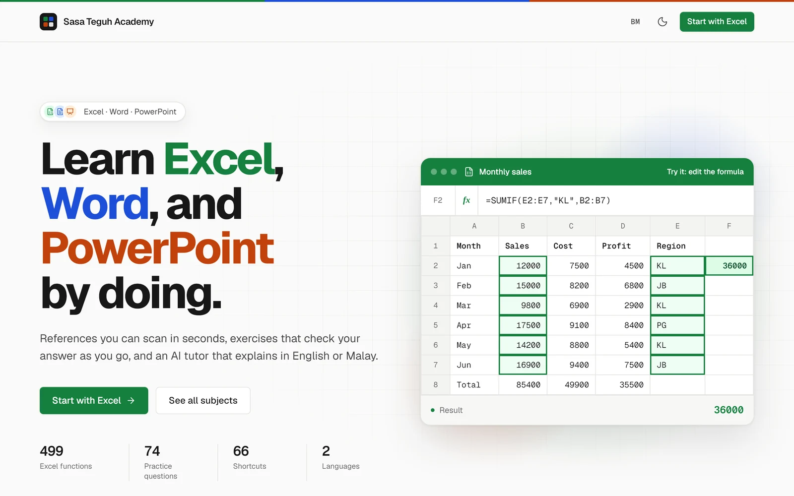
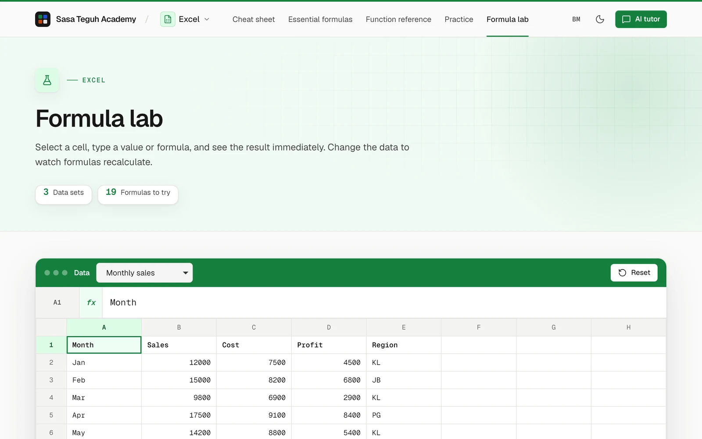
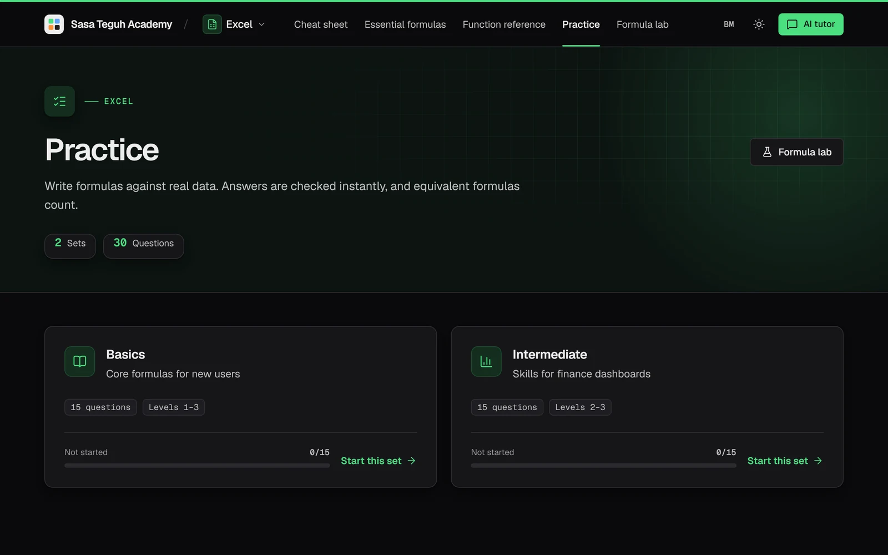

# Office AI Tutor

A self-hosted learning site for Microsoft Office classes, **Excel, Word and PowerPoint**, in **Malay and English**.
It runs a real class at [academy.sasateguh.com](https://academy.sasateguh.com) (Malay at `/`, English at `/en/`).

Each subject has a cheat sheet, a searchable reference, auto-checked exercises and an AI tutor that answers in the
language of the question. Excel also has a formula lab: a grid that evaluates Excel formulas in the browser.

<picture>
  <source media="(prefers-color-scheme: dark)" srcset="docs/screenshots/home-dark.webp">
  
</picture>

| Formula lab | Practice (dark theme) |
|---|---|
|  |  |

<sub>Screenshots of the live site (English pages), WebKit, 1280 × 800.</sub>

> **Ringkasan BM:** laman belajar Microsoft Office dalam Bahasa Melayu dan Inggeris: rujukan pantas, rujukan lengkap,
> latihan bersemak automatik, makmal formula Excel dan tutor AI. Kod sumber terbuka (AGPL-3.0); kandungan hak terpelihara.

## Features

- **Bilingual by design.** Interface text lives in `app/config/bahasa/{ms,en}.php`; every content pack has a Malay file and an
  English file with the same structure (`app/config/pek/<subject>/` and `.../en/`). `php app/alat/semak-kandungan.php` fails
  when the two drift apart (missing questions, different answers, different shortcut keys) or when copy breaks the style guide
  (`docs/STYLE-GUIDE.md`: banned marketing words, no emoji, no colloquial Malay).
- **Subjects as data.** A subject is one entry in `app/config/subjek.php` plus a content pack. URLs are
  `[/en]/<subject>/<page>` (`cheatsheet`, `formulas`, `reference`, `practice`, `playground`, `tutor`), served by one front
  controller (`app/public/laman.php`). Old URLs redirect with 301.
- **Exercises**: write a formula, type a result, multiple choice, or *press the keyboard shortcut* (records physical keys;
  Ctrl ≡ ⌘). Formula answers are also accepted when they are *equivalent* (same cells, constants and functions, written
  differently, e.g. `=SUM(B4,B3,B2)` for `=SUM(B2:B4)`), but not when the result only matches by coincidence. Answers never
  reach the browser.
- **Formula engine** (`app/public/assets/js/formula-enjin.js`): own parser/evaluator on top of
  [@formulajs/formulajs](https://github.com/formulajs/formulajs) (MIT), with Excel semantics where they matter for teaching
  (date serials, wildcard criteria, lookup modes, 15-digit comparison). `tests/enjin.test.js` checks 90 cases against real
  Excel. Not yet: FILTER, LET, array constants, cross-sheet references.
- **AI tutor** via [Groq](https://groq.com) with a key pool (rotates on 429/5xx, cools down failing keys), per-subject and
  per-language system prompts editable in the admin panel.
- **Admin panel** (`/admin.php`): chat on/off, model selection checked live against the provider, key pool, exercise editor
  per subject and language (form or JSON from an AI, validated), history with one-click restore, publish/draft per subject,
  privacy-friendly statistics (no IP, no student cookies, bots excluded), password change.
- **Design**: light and dark themes from CSS tokens, self-hosted Geist fonts (OFL), Lucide icons (ISC, generated into
  `app/src/Ikon.php` by `alat/jana-ikon.py`). Tested on WebKit (iPhone 13) and Chromium, with axe-core in both themes.
- No framework and no build step at runtime: PHP 8.2+, Tailwind compiled once (`tailwind/`).

## Run locally

```bash
cp app/config/.env.example app/config/.env          # set ADMIN_PASSWORD_HASH (instructions inside)
echo '[{"id":"k1","key":"gsk_…","label":"main"}]' > app/config/groq-keys.json   # optional: Groq key(s) for the AI tutor
mkdir -p app/data
php -S localhost:8000 -t app/public dev/router.php
```

Production runs on Apache (`mod_rewrite`, `mod_headers`) behind a reverse proxy; `app/public` is the document root and
`app/src`, `app/config`, `app/data` must stay outside it. The router in `dev/` mirrors the production rewrites.

Site name, owner, instructor and contact live in `app/config/laman.php`.

The compiled CSS (`app/public/assets/css/tw.css`, `tw-admin.css`) and the icon set (`app/src/Ikon.php`) are committed, so
the site runs without Node. After adding Tailwind classes in PHP or JS, or icons, rebuild them (Node 22):

```bash
cd tailwind && npm install && npm run build    # CSS
npm run icons                                  # app/src/Ikon.php from lucide-static (needs Python 3)
```

CI rebuilds both from a clean checkout and fails if the committed files differ.

## Licensing

| What | License |
|---|---|
| Code (PHP, JS, CSS, templates, tests) | **AGPL-3.0**, see `LICENSE`. If you run a modified version as a network service, you must offer its source to its users. |
| Teaching content: `app/config/pek/**`, `app/config/formulas/**`, `app/config/bahasa/**` | **All rights reserved**, see `CONTENT-LICENSE.md`. |
| Third-party: formulajs (MIT), marked (MIT), DOMPurify (Apache-2.0 / MPL-2.0), Lucide icons (ISC), Geist fonts (OFL-1.1) | Their own licenses, in `app/public/assets/vendor/` and `app/public/assets/fonts/`. |

## Trademarks

Microsoft, Excel, Word and PowerPoint are trademarks of Microsoft Corporation. This project is not affiliated with,
sponsored or endorsed by Microsoft. "Office AI Tutor" is a descriptive project name, not a claim to those marks.

## How this was built

office-ai-tutor was built with AI coding assistance (Claude Code) under the direction of its author, Muhammad Aiman.

The evidence that it works is meant to be checkable:

- The test suite, run with `node tests/enjin.test.js app` and `php app/alat/semak-kandungan.php`.
- CI on PHP 8.2 and 8.3, and Node 22 for every pull request.

## Contributing

See `CONTRIBUTING.md`. In short: this repository is published from a private one, so an accepted pull request is applied
there and arrives here with the next sync.

## Security

See `SECURITY.md` to report a vulnerability, and `SECURITY-REVIEW.md` for the independent reviews done before this
repository was made public.

## Work with Sasa Teguh

[](https://sasateguh.com/book)

This project is built and maintained by [Sasa Teguh](https://sasateguh.com), a studio in Malaysia. We build websites that are found on Google and in AI answers, and we set up systems like this one for businesses.

[Book a call](https://sasateguh.com/book) · hello@sasateguh.com · [More from Sasa Teguh](https://github.com/sasateguh)
